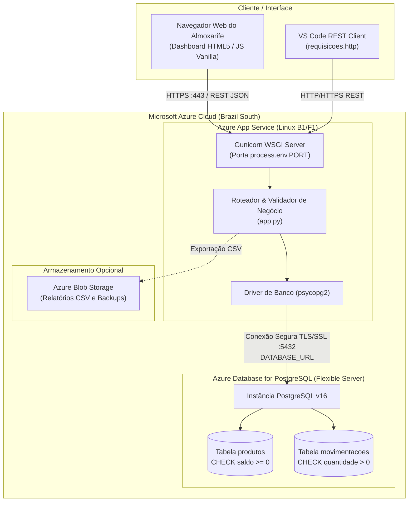

# Evidência E4: Diagrama de Arquitetura e Decisões Técnicas

## 1. Diagrama de Arquitetura em Nuvem



---

## 2. Caminho de uma Requisição de Saída (Fluxo Crítico da Regra Central)

1. O almoxarife submete a retirada de um item (`POST /api/produtos/1/movimentacoes` com `{ tipo: "saida", quantidade: 7 }`).
2. O App Service recebe o payload, valida no servidor os campos (`quantidade > 0`, `motivo preenchido`).
3. Uma transação ACID é iniciada no PostgreSQL.
4. O motor executa a instrução atômica com predicado de guarda:
   ```sql
   UPDATE produtos 
   SET saldo = saldo - 7 
   WHERE id = 1 AND saldo >= 7;
   ```
5. **Verificação imediata do lock:** Se o saldo atual for 6, a condição `saldo >= 7` é falsa. Nenhuma linha é alterada (`rows_affected = 0`).
6. A aplicação detecta a falha, executa `ROLLBACK;` imediato e devolve status **409 Conflict** ao cliente.
7. O banco permanece íntegro, sem saldo negativo e sem registro espúrio no histórico de movimentações.
